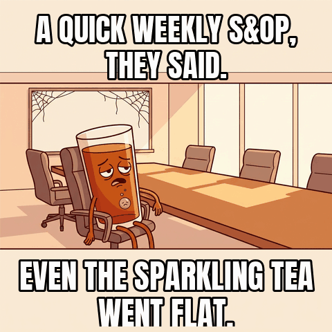
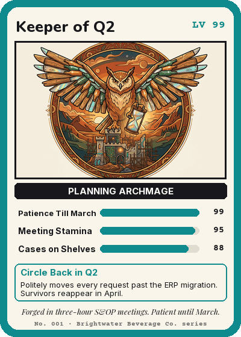
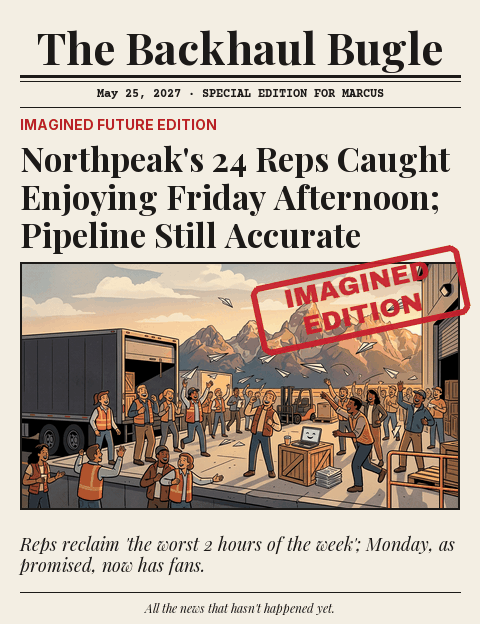

# Inside Joke

[](https://github.com/nahrahel-harvard/inside-joke/actions/workflows/ci.yml)
[](LICENSE)

Inside Joke turns a few public facts about someone's job (title, company, industry, a note or 2, and optionally what they said in an email thread) into a small animated GIF with a joke written for that person. Models write 3 candidate jokes in parallel, ordinary code throws out any that break the rules, a model from a different company judges the rest, and Python draws every letter and frame. A finished set of 5 GIFs takes about 30 seconds and about $0.50. It is also the instrument for a small study: when a personalized joke costs almost nothing to make, do people still read it as effort?

<p>
  
  
  
</p>

**Live site:** [nahrahel-harvard.github.io/inside-joke](https://nahrahel-harvard.github.io/inside-joke/)

## Quickstart

You need Python 3.11 or newer.

```bash
git clone https://github.com/nahrahel-harvard/inside-joke
cd inside-joke
make setup     # creates .venv, installs pinned dependencies
make test      # offline test suite, no API key
make demo      # renders all 5 formats with placeholder art into out/demo
```

To make real GIFs, add an [OpenRouter](https://openrouter.ai) key:

```bash
cp .env.example .env            # then set OPENROUTER_API_KEY in .env
.venv/bin/python forge.py examples/dana_brightwater.json --format all
```

Output lands in `out/<run>/`: 1 GIF and 1 PNG poster per format, `manifest.json` with every concept, score and cost, and an `index.html` gallery.

Useful flags:

| Flag | Effect |
|---|---|
| `--format meme,card` | Pick formats (`meme`, `headline`, `comic`, `card`, `reply`) or `all` |
| `--art svg` | Draw art as SVG with a text model. Works with no image credit. |
| `--art placeholder` | No art model at all |
| `--fast` | Faster writer, no judge |
| `--context "..."` | Conversation text. Reply Reaction needs it. |
| `--research` | Read the prospect's homepage first |

The web app does the same thing with a form and live progress:

```bash
.venv/bin/python serve.py      # then open http://127.0.0.1:8765
```

Image output on OpenRouter (`google/gemini-3.1-flash-image`) needs an account balance of at least $1; below that it returns 402. `--art auto` then falls back to SVG, which works with no image credit.

## The 5 formats

| Format | What it is | Motion |
|---|---|---|
| Meme Desk | An original 2-beat meme: setup on top, punchline below | The punchline drops in |
| Future Headline | A trade-paper front page dated 6 months ahead, reporting the win the person is working toward, stamped "Imagined edition" | The headline types itself, then the stamp lands |
| Three-Panel Day | A 3-panel strip about 1 real pain from the role, ending on a kind twist | Panels fade in 1 at a time |
| Collector Card | A collectible card for the person's professional persona: nickname, 3 stats, a special move | Stat bars fill, then a light band sweeps the card |
| Reply Reaction | Reacts to what the person said in the thread | A calendar flip, progress bar or stamp delivers the beat |

## How it works

```
facts ──> 3 writer calls in parallel (1 humor mechanism each)
      ──> deterministic guardrails (code)
      ──> judge from a different model family (funny, specific, kind, glance)
      ──> art: image model, else SVG, else placeholder
      ──> render.py draws every letter and frame
      ──> GIF under 1 MB, finished frame first
```

- **Best of 3.** The writer runs at temperature 1.0, so any single draw can miss. Each format gets 3 drafts, each built on a different humor mechanism (incongruity, exaggeration, personification, or callback when there is conversation context), and the best passing draft wins.
- **Words drawn by code.** Art models are told to draw no text. `render.py` places every letter, so names are always spelled right. The same art and text give byte-identical GIFs on the same day; the headline dateline and the reply calendar use today's date.
- **Outlook-safe.** Some desktop versions of Outlook show only frame 1, so frame 1 is a 20 ms copy of the finished image.
- **Motion grammar.** For Reply Reaction the model picks 1 of 3 named animations (`calendar_flip`, `progress_bar`, `stamp`). It never writes animation code.

Full detail, including which stages are deterministic, the model routing table and the size budget: [docs/ARCHITECTURE.md](docs/ARCHITECTURE.md).

## Guardrails

The rules are a governed policy, described in full in [GOVERNANCE.md](GOVERNANCE.md) and pinned by `tests/test_guardrails.py`.

1. **The joke targets a shared annoyance of the job**: a meeting, a tool, a metric, a season. The writer prompt rules out jokes about the reader.
2. **Banned topics.** Code rejects any concept that mentions appearance, age, health, family, religion, politics, layoffs or lawsuits.
3. **Grounding.** Every personal detail must cite the input field it came from. Code rejects a concept that cites a field missing from the input. This is a cheap, checkable defense against invented facts; a human still checks that each fact matches its field.
4. **First name at most once** (counted case-insensitively), spelled exactly as given. Generic renders say "you" in place of a name.
5. **Kindness bar.** When the judge runs, it scores "kind" from 1 to 10. A concept below 7, or one the judge leaves unscored, gets a total of -1 and is ranked out; if every concept is below the bar, the format fails. The judge runs only when 2 or more concepts pass the guardrails and `--fast` is off. If the judge call errors, the first passing concept is used.
6. **Human review is the final gate.** The tool never sends anything. A person reads every GIF before it reaches a real person.

## Research question

When generative AI makes a personalized joke nearly free to produce, do recipients still read it as a sign of effort, and what changes when they are told AI made it?

The plan in [docs/RESEARCH_PLAN.md](docs/RESEARCH_PLAN.md) is a 2 x 3 mixed design with about 30 consenting adult participants (classmates, friends and housemates). Each person rates 3 items: a personalized GIF, a personalized joke as plain text, and a generic office-life GIF. Half see a label saying "Alex made this with an AI tool in about 20 seconds." Hypotheses, fixed before data collection:

- **H1, signal.** The personalized GIF reads as more effort than the generic GIF (costly signaling).
- **H2, disclosure discount.** The AI label shrinks that gap.
- **H3, privacy cost.** The personalized GIF feels creepier than the generic one.
- **H4, medium.** The personalized GIF is funnier than the same kind of joke as text.
- **M1, measurement.** How well the judge model's scores track human ratings (Spearman rho per dimension).

The study also measures how non-deterministic the pipeline is: distinct jokes per input, first-attempt guardrail pass rate, and judge test-retest agreement.

## Cost and speed

Measured on 2026-11-24 with fictional personas, all 5 formats per run.

| Run | Change | Wall clock | JSON repairs | Cost |
|---|---|---|---|---|
| 1 | 1 writer call wrote all 3 concepts | 70 s | every call | $0.48 |
| 2 | 3 parallel writer calls, 1 per mechanism | 35 s | 15 of 33 writer calls | not noted |
| 3 | Plus a separate 1,024-token reasoning budget (Dana) | 32 s | 0 | $0.49 |
| 4 | Same code (Marcus) | 31 s | not noted | $0.48 |

Across all real runs that day: 22 to 32 s per format, 30 to 32 s wall clock for all 5 formats, GIFs 113 to 392 KB, about $0.10 per GIF. Image calls cost about $0.067 each. Run 4 judge totals ranged from 6.25 to 9.15 on a 10-point weighted scale. With `--fast` (faster writer, no judge), a GIF took 15.6 to 16.9 s at about $0.067. Claude Sonnet 5.5 reports $0 cost on this OpenRouter account, so true text cost is higher than shown.

The run 2 repairs had 1 root cause. Claude Sonnet 5.5 on OpenRouter makes reasoning mandatory, and reasoning tokens count against `max_tokens`: 689 of 800 tokens went to reasoning, and the writer returned only `{"`. The fix was a separate reasoning budget plus a hard error on `finish_reason` "length".

Offline rendering with placeholder art takes about 0.05 to 0.08 s per format and makes GIFs of about 60 to 140 KB.

## Project layout

```
inside-joke/
├── forge.py                  CLI: prospect JSON in, GIFs and gallery out
├── serve.py                  local web app (stdlib HTTP server)
├── web/index.html            web app front end
├── inside_joke/
│   ├── config.py             model routing, bundled fonts, API key loading
│   ├── llm.py                OpenRouter client, retries, cost ledger
│   ├── research.py           optional homepage fetch
│   ├── formats.py            the 5 format specs
│   ├── concept.py            writer, guardrails, judge, ranking
│   ├── art.py                image, SVG and placeholder art
│   ├── render.py             frame renderers and GIF encoder
│   └── pipeline.py           run(): formats in parallel, manifest.json
├── study/                    study toolkit: assignment, batch runs, rating pages, analysis
├── examples/                 fictional prospects (Dana, Marcus)
├── fonts/                    OFL fonts and their licenses
├── scripts/build_site.py     builds the GitHub Pages site
├── tests/                    offline unittest suite and shared fixtures
│   └── test_art_grid.py      grid detector tuned on real outputs
├── docs/
│   ├── ARCHITECTURE.md
│   ├── PROCESS_LOG.md
│   ├── RESEARCH_PLAN.md
│   └── STUDY_RUNBOOK.md
├── site/                     GitHub Pages site
├── .github/                  CI, templates, CODEOWNERS, Dependabot
├── GOVERNANCE.md  CONTRIBUTING.md  SECURITY.md  CODE_OF_CONDUCT.md
├── CHANGELOG.md  LICENSE  Makefile  pyproject.toml
├── requirements.txt          pipeline: pillow, resvg-py
├── requirements-study.txt    plus numpy, scipy, matplotlib for study/
└── .env.example
```

## Tests and CI

`make test` runs the full suite with `unittest`. Every model call is faked, so it needs no key and no network. It covers the guardrails (including a regression test for a real false positive on "OLD"), all 5 renderers (size, first-frame rule, byte-for-byte determinism, 30-word captions), the LLM client (reasoning budget, truncation errors, ledger), the pipeline's manifest contract, the web app's validation and path handling, and the study toolkit.

CI runs ruff and the suite on Python 3.12 and 3.13, then renders all 5 formats offline and uploads the GIFs as a workflow artifact.

## Course context

Final project for Harvard CS 85 (Fall 2026), taught by Dr. Christopher Thorpe. Module 7, option B (Explore). Due Dec 4 2026. The research plan is in [docs/RESEARCH_PLAN.md](docs/RESEARCH_PLAN.md), and [docs/PROCESS_LOG.md](docs/PROCESS_LOG.md) records how the prototype changed run by run.

Disclosure of interest: the author runs a B2B outbound agency, which is why the hypotheses and analysis were fixed before any data was collected.

## Ethics

- Every example, test fixture and GIF in this repo is made for a fictional person at a fictional company.
- Art never depicts a real person. Prompts ask for generic stylized characters or objects, and the SVG path strips embedded images.
- A human reads every GIF before it reaches a real person. The tool has no sending feature.
- Facts you enter are sent to OpenRouter and the model providers it routes to (Anthropic, Google). Enter only what would appear on a public profile.
- Study participants consent first, may use an invented persona, and have their data deleted by Dec 18 2026. See section 4 of the research plan.

## License

Code: [MIT](LICENSE), copyright 2026 Nahrahel Louis. Fonts in `fonts/`: SIL Open Font License 1.1, see [fonts/README.md](fonts/README.md).
