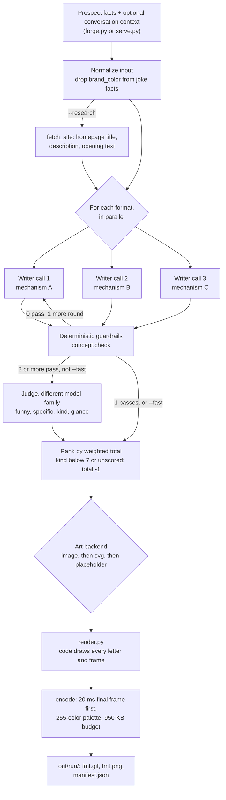

# Architecture

Inside Joke splits each GIF into 2 kinds of work. Models do the parts that need taste: writing jokes, judging them, drawing a scene. Plain Python does the parts that must be exact: checking the rules, placing every letter, timing every frame, and keeping the file small. The split is what makes the output testable.

## Pipeline

`pipeline.run()` drives it. Each format runs in its own thread, so wall-clock time for 5 formats is close to the slowest single format. One format failing returns `ok: false` with an error for that format only; the others still finish.

## Which stages are deterministic

| Stage | Code | Deterministic? | Why |
|---|---|---|---|
| Normalize input | `pipeline.run` | Yes | Keeps known keys, strips whitespace, removes `brand_color` from the facts the models see. |
| Homepage research (optional) | `research.fetch_site` | No | Reads a live web page, which can change or fail. Off by default and off for the study. |
| Writer, 3 calls | `concept.write_concepts` | No | Temperature 1.0 on purpose. Variety is the point, so the pipeline draws 3 and selects. |
| JSON repair | `llm.chat_json` | No | A second model call at temperature 0. Providers do not promise identical output even at 0. |
| Guardrails | `concept.check` | Yes | Ordinary code. Same concept, same verdict, every time. Covered by `tests/test_guardrails.py`. |
| Judge | `concept.judge` | No | Temperature 0, but still a model call. The research plan measures its test-retest agreement. |
| Ranking and kindness bar | `concept.pick` | Yes, given the scores | Weighted sum (funny 0.35, specific 0.30, glance 0.20, kind 0.15), then a sort. Kind below 7, or no score from the judge, sets the total to -1; if all are below the bar the format fails. With `--fast`, 1 passing concept, or a judge error, the first passing concept is used. |
| Art, image backend | `art._image_art` | No | Image model output differs on every call. |
| Art, SVG backend | `art._svg_art` | No for the drawing, yes after | The text model's SVG varies. Sanitizing and resvg rasterizing are deterministic. |
| Art, placeholder | `art.placeholder` | Yes | A fixed gradient and circle per panel index. |
| Render | `render.render` | Yes, on the same day | Same art and text give the same frames. The headline dateline and the reply calendar read today's date. |
| Encode | `render.encode` | Yes | Same frames give byte-identical GIF and PNG files. `tests/test_render.py` checks this. |
| Manifest | `pipeline.run` | No | Carries timestamps, timings and costs. |

## Model routing

All defaults live in `MODELS` in `inside_joke/config.py`. Each one can be overridden with an environment variable, so experiments need no code change. Every call goes through OpenRouter.

| Role | Default model | Override | Temperature | Output budget |
|---|---|---|---|---|
| Writer | `anthropic/claude-sonnet-5.5` | `IJ_WRITER` | 1.0 | 1,600 tokens + reasoning |
| Writer with `--fast` | `anthropic/claude-haiku-5.5` | `IJ_WRITER_FAST` | 1.0 | 1,600 tokens + reasoning |
| Judge | `google/gemini-3.6-flash` | `IJ_JUDGE` | 0 | 1,200 tokens + reasoning |
| SVG artist | `anthropic/claude-sonnet-5.5` | `IJ_SVG` | 0.7 | 7,000 tokens + reasoning |
| Image | `google/gemini-3.1-flash-image` | `IJ_IMAGE` | provider default | 1 image |
| Image fallback | `google/gemini-3.1-flash-lite-image` | `IJ_IMAGE_FALLBACK` | provider default | 1 image |

The judge is a different model family from the writer so a model does not grade its own work.

### Reasoning budget

Claude Sonnet 5.5 on OpenRouter makes reasoning mandatory ("Reasoning is mandatory for this endpoint and cannot be disabled"), and reasoning tokens count against `max_tokens`. For any model starting with `anthropic/` or `google/gemini`, `llm.chat` adds a separate reasoning budget of 1,024 tokens and raises `max_tokens` to the requested output plus 1,024 plus 200. If a response still ends with `finish_reason` "length", `llm.chat` raises `LLMError`. A truncated fragment is never sent to JSON repair.

## Art backends

`--art auto` tries these in order and records which one worked in `results[fmt].art_backend`:

1. **image**: the OpenRouter image model, then the fallback image model. A 402 (no image credit) skips the fallback, since it would fail the same way. OpenRouter needs a balance of at least $1 for image output.
2. **svg**: a text model draws the scene as 1 `<svg>` element. Code strips `<text>`, `<script>`, `<foreignObject>`, `<image>` and external links, then resvg rasterizes it at 2x and crops to size. This works with no image credit.
3. **placeholder**: a gradient with a circle. It needs no network, so the pipeline always finishes.

`--art image`, `--art svg` and `--art placeholder` pin a backend (image and svg still fall back to placeholder on failure). Image calls retry only on 429, 502, 503 and connection failures; a timeout or a 500 is not retried. Art models are told to draw no words.

Each format has an image-only `composition` line that is added to the art prompt, kept apart from the writer-facing `art_note`. Comic prompts start with "Scene:". After an image comes back, `art.looks_like_grid` checks it for a multi-panel layout and redraws once if it finds one. On real outputs it caught 6 of 9 known grids with 0 false alarms on 25 single-scene images (`tests/test_art_grid.py`).

The SVG sanitizer removes every `href` that is not a `#fragment` link, and namespaced `image` and `feImage` elements, along with the elements listed above. Every letter in the GIF comes from `render.py`, so names are always spelled right.

## Motion grammar

The Reply Reaction format lets the model pick 1 of 3 named motion primitives in `text.prop`. The model never writes animation code. `concept.check` rejects any other value.

| Primitive | `prop_value` | What it does |
|---|---|---|
| `calendar_flip` | 3-letter month, for example `APR` | A desk calendar flips month by month from the current month to the target, 120 ms per page with alternating 6 degree tilts, then settles upright at 1.08x. An unknown month falls back to the month 3 after the current one. |
| `progress_bar` | 1 to 3 word label | A card with the label fills a green bar through 0, 25, 55, 80, 97 and 100 percent at 140 ms per step. An empty label shows "Loading". |
| `stamp` | 1 to 2 words | A rubber stamp drops in at 1.9x, then 1.3x (50 ms each), and lands at 1.0x tilted 10 degrees. An empty value stamps "Noted". |

After the prop settles, the second caption appears in a dark bar and the final frame holds for 3.2 s.

The other 4 formats have fixed motion: the meme punchline drops in at 1.35x, 1.15x and 1.0x; the headline types itself 1 or 2 words per frame and ends with an "Imagined edition" stamp; the comic fades in 1 panel at a time; the collector card fills its stat bars and then sweeps a light band across the face.

## Size budget and the Outlook first-frame rule

`render.encode` does the following:

1. Merges consecutive identical frames into 1 longer frame.
2. Saves the final frame as a PNG poster.
3. When `outlook_safe` is on (the default), puts a 20 ms copy of the final frame first. Some desktop versions of Outlook show only frame 1, so frame 1 carries the whole joke.
4. Builds 1 shared 255-color palette from up to 5 sampled frames, with no dithering, and writes the GIF with `loop=0`.
5. If the file is over 950 KB, scales every frame by 0.85 and tries again, until it fits or the scale drops below 0.55 (4 steps at most).

Tests check that frame 1 lasts 20 ms, that it matches the last frame and the PNG poster, that every format stays under 1 MB, and that 2 renders of the same input produce identical bytes.

## Measured numbers

From real runs on 2026-11-24 with fictional personas. Wall clock covers all 5 formats in 1 run.

| Run | Setup | Wall clock | Repairs | Guardrail rejections | Cost |
|---|---|---|---|---|---|
| 1 | 1 Sonnet 5.5 call wrote all 3 concepts | 70 s | every call | included a false positive on "OLD" | $0.48 |
| 2 | 3 parallel writer calls, 1 per mechanism | 35 s | 15 of 33 writer calls | not noted | not noted |
| 3 | Plus 1,024-token reasoning budget; Dana, fictional supply chain director | 32 s | 0 | 0 | $0.49 |
| 4 | Same code; Marcus, fictional VP of Sales | 31 s | not noted | not noted | $0.48 |

Run 1 details: each single writer call took 23 to 26 s, and the image model drew a 4-panel grid inside each comic panel.

Run 2 details: the comic failed. One raw response showed the writer had returned only `{"`: 689 of 800 tokens had gone to mandatory reasoning. The Gemini 3.6 Flash judge hit the same limit (`finish_reason` "length").

Across all real runs that day:

| Measure | Value |
|---|---|
| Wall clock, all 5 formats | 30 to 32 s |
| Per-format time | 22 to 32 s |
| GIF size | 113 to 392 KB |
| Cost per GIF | about $0.10 |
| Cost per image call | about $0.067 |
| `--fast` per GIF | 15.6 to 16.9 s, about $0.067 |
| Judge totals (run 4) | 6.25 to 9.15 on the 10-point weighted scale |

Sonnet 5.5 cost reports as $0 on this OpenRouter account, so true text cost is understated in every ledger total above.

Offline render with placeholder art (`make demo`): about 0.05 to 0.08 s per format, GIFs of about 60 to 140 KB.

## Files

| File | Role |
|---|---|
| `inside_joke/config.py` | Model routing, fonts, API key loading |
| `inside_joke/llm.py` | OpenRouter client, retries, ledger, JSON parsing |
| `inside_joke/research.py` | Optional homepage fetch |
| `inside_joke/formats.py` | The 5 format specs: fields, word limits, panels, art size and notes |
| `inside_joke/concept.py` | Writer prompts, guardrails, judge, ranking |
| `inside_joke/art.py` | Image, SVG and placeholder backends |
| `inside_joke/render.py` | Frame renderers and GIF encoder |
| `inside_joke/pipeline.py` | `run()`: parallel formats, events, manifest |
| `forge.py` | CLI and static gallery |
| `serve.py`, `web/index.html` | Local web app |
